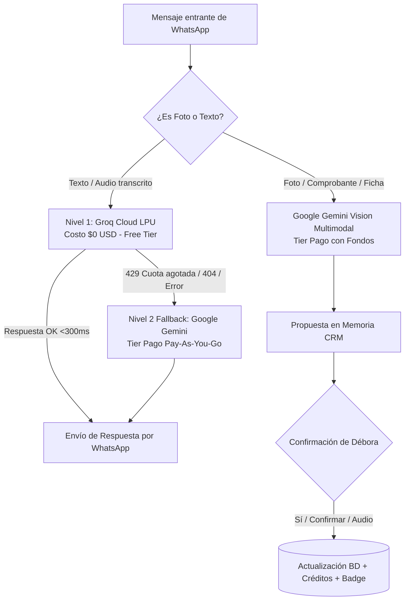

# Arquitectura de Inteligencia Artificial y Gestión de Cuotas
**Violett Pilates — Sistema Asistente y CRM Autónomo**

Este documento detalla la arquitectura técnica de Inteligencia Artificial implementada en el sistema de Violett Pilates, diseñada para operar con **costo mínimo ($0 USD en consumo habitual)** garantizando al mismo tiempo **cero caídas y disponibilidad permanente** mediante una cuenta de respaldo financiada en Google AI Studio.

---

## 1. Estrategia Híbrida de Dos Niveles (Tier 1 Gratis + Tier 2 Pago)



---

## 2. Nivel 1: Groq Cloud (Prioritario — Costo $0 USD)

* **Objetivo:** Atender más del 90% de los mensajes de texto cotidianos (turnos disponibles, consultas de precios, cancelaciones de alumnas, saludos, reportes rápidos) con velocidad ultra-alta (latencia <300 ms en chips LPU) sin costo de API.
* **Modelos configurados en cascada:**
  1. `llama-3.3-70b-versatile` (Modelo principal de 70B de máxima inteligencia).
  2. `llama-3.1-8b-instant` (Modelo liviano de 8B de respuesta inmediata).
  3. `llama3-8b-8192` (Modelo de respaldo adicional).
* **Límites oficiales de Groq Free Tier:**
  * **Tope diario de la plataforma:** 14.400 peticiones por día.
  * **Límites de 70B:** 1.000 peticiones por día (RPD) y 6.000 tokens por minuto (TPM).
  * **Límites de 8B:** 14.400 peticiones por día (RPD) y 30.000 tokens por minuto (TPM).
* **Comportamiento ante saturación:** Si se alcanza cualquiera de estos topes de Groq o el servicio experimenta interrupciones, el sistema **no se cae ni rechaza el mensaje**: activa automáticamente el Nivel 2.

---

## 3. Nivel 2: Google Gemini (Respaldo Ilimitado y Visión — Cuenta de Pago)

* **Objetivo:** Actuar como red de seguridad definitiva cuando Groq agota su cuota gratuita o presenta errores, y procesar de forma exclusiva todas las **imágenes, fichas físicas y comprobantes bancarios**.
* **Estado de la cuenta:** **Pay-As-You-Go (Tier de Pago con fondos)** en Google AI Studio.
* **Modelos configurados en cascada:**
  1. `gemini-1.5-flash`: Modelo de producción insignia para razonamiento, tool-calling y OCR multimodal.
  2. `gemini-2.0-flash`: Modelo de última generación con cuota independiente (2.000 RPM / 4M TPM).
  3. `gemini-2.5-flash`: Modelo con cuota activa en tu panel (1.000 RPM / 1M TPM).
  4. `gemini-3.8-flash`: **Salvavidas definitivo garantizado**. Es el modelo de máxima capacidad y estabilidad en tu proyecto de Google AI Studio (1.000 RPM / 138.61K TPM), configurado al final de la cadena para responder con éxito si cualquier modelo previo llegara a fallar.
* **Límites oficiales de Google AI Studio (Referencia: [docs/rate-limits](https://aistudio.google.com/docs/rate-limits)):**

| Métrica | Free Tier de Google (Sin tarjeta) | Pay-As-You-Go (Cuenta Violett con fondos) |
| :--- | :--- | :--- |
| **Peticiones por minuto (RPM)** | 15 RPM | **1.000 a 2.000 RPM** |
| **Tokens por minuto (TPM)** | 1.000.000 TPM | **4.000.000 TPM** |
| **Peticiones por día (RPD)** | 1.500 RPD (Tope duro diario) | **ILIMITADO (Sin tope diario)** |
| **Límite de Gasto Rodante** | No aplica | Control preventivo de 10 min contra picos |
| **Visión Multimodal (OCR)** | Básica / Lenta | **Alta precisión en letra manuscrita y firmas** |

---

## 4. Diagnóstico del Error 404 de Groq en la Bitácora Centinela

Durante las pruebas recientes, la Bitácora Centinela registró los tickets `#ERR-834beb9f` y `#ERR-8935ef6f` con el siguiente mensaje:
```text
Error code: 404 - {'error': {'message': "The model 'llama-3.1-8b-instant' does not exist or you do not have access to it.", 'type': 'invalid_request_error', 'code': 'model_not_found'}}
```

### ¿Por qué ocurrió esto?
1. **Restricción de Project / Clave en Groq Console:** En Groq Cloud, las API Keys creadas dentro de organizaciones o proyectos específicos pueden tener restringido el acceso a ciertos modelos particulares si la configuración de la clave no habilitó todos los modelos del catálogo.
2. **Cadena de Fallback Incompleta:** En versiones previas del archivo `base.py`, cuando Groq disparaba esta excepción 404, la lista de fallbacks intentó enlazar un nombre de modelo experimental (`gemini-2.5-flash`) que no existe en Google AI Studio, lo que provocó que el orquestador abortara y cayera en el modo de simulación de emergencia.

### ¿Cómo quedó resuelto de forma definitiva?
* **Enlace seguro de herramientas:** Si un proveedor o modelo secundario falla al preparar sus herramientas, el error se aísla con un bloque `try/except` y no interrumpe el resto de los modelos válidos.
* **Relevo garantizado hacia Gemini Payg:** Ante cualquier código `404 (model not found)`, `429 (rate limit)` o `500` de Groq, la petición pasa inmediatamente a `gemini-1.5-flash` y `gemini-2.0-flash` en la cuenta paga de Google sin que el usuario de WhatsApp experimente demoras ni fallos.

---

## 5. Procesamiento y Sincronización de Fichas Físicas

1. **Lectura Inteligente:** Al enviar una fotografía de la planilla física de asistencia de una alumna, la imagen es procesada directamente por **Google Gemini Multimodal**, extrayendo:
   * Nombre de la alumna.
   * Clases tomadas con fechas manuscritas (ej: `14|10|26`, `06/11/26`).
   * Firmas de asistencia y anotaciones especiales (ej: `"Vino"`, `"Ausente"`).
   * Detección de corte de planes (líneas horizontales divisorias entre abonos viejos y abonos nuevos).
2. **Propuesta en Espera de Aprobación:** El bot genera un resumen prolijo en WhatsApp y almacena la propuesta en `conversacion.metadata['propuesta_ficha_alumna']`.
3. **Confirmación Inmune a Modos de Falla:**
   * Tanto en el flujo normal con IA como en el modo de simulación o emergencia, si existe una ficha pendiente de aprobación y Débora o el Staff responden **"Confirmar"**, **"Sí"**, **"Dale guardalo"**, **"Exactamente"** o envían un audio ratificándolo:
   * El sistema ejecuta de forma prioritaria `confirmar_sincronizacion_ficha_duena(decision="CONFIRMAR")`.
   * Se registran las clases en la base de datos con el badge oficial de **"Modificada"**.
   * Se reconcilian los créditos restantes del abono de la alumna para que la agenda web y la contabilidad queden 100% al día.
